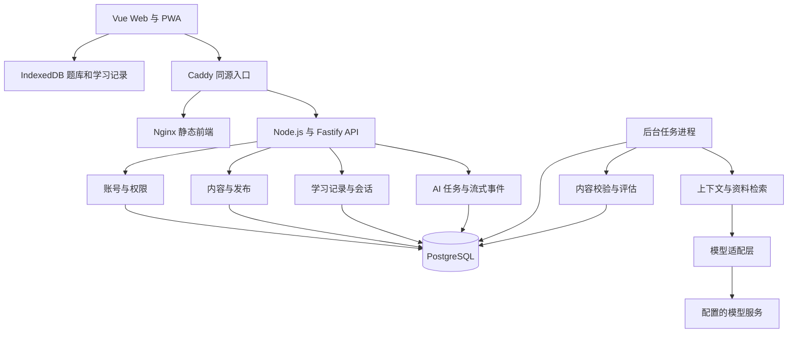

# 知序 AI 学习与动态题库建设方案

日期：2026 年 11 月 23 日

状态：A～C 首期代码与本地验收完成；点评、动态追问和模拟复盘已接入；DeepSeek 完整真实链路通过，生产待验收

代码基线：`2fd31f0`；题库版本：`2026.11.23-quality.1`

本方案把知序从固定题库练习应用升级为支持自由答疑、回答点评、动态追问和按需出题的学习应用。保留现有 Vue 响应式 Web + PWA，增加独立的「AI」导航入口、题目内的上下文对话、后端内容服务和可审核的动态题库。

首期按个人使用和小范围邀请设计。优先交付「遇到问题能问清楚、练习不足能补题、新内容无需重新部署」三个结果，再完善模拟面试和个性化复习。本文中的配额、性能指标和质量门槛均为建议的实施目标，实际模型、费用与服务器容量需要在接入阶段测量。

阅读顺序：第 2～4 节说明入口、功能和内容质量；第 5～9 节说明架构、数据、接口和迁移；第 10～12 节说明权限、费用和验收；第 13～16 节说明代码改造、分期与上线。

## 1. 当前基础与需要解决的问题

### 1.1 已有能力

当前项目采用 Vue 3、TypeScript、Pinia、Vue Router、Vite 和 IndexedDB。服务器提供静态资源，题库随前端构建发布；没有账号服务、远程内容 API、云端同步或在线 AI。

| 项目     | 当前情况                                              |
| -------- | ----------------------------------------------------- |
| 独立题目 | 1011 道：195 道选择题、64 道判断题、752 道口述题      |
| 内容组织 | 31 个专题、163 条追问链、30 个追问分组、30 项简历对照 |
| 专题规模 | 每个专题引用 20～54 道题；不同专题可共享同一道题      |
| 练习方式 | 专题、章节、口述追问、错题复习、固定模拟面试          |
| 学习记录 | 本地进度、笔记、草稿、收藏、自评、备份导入导出        |
| 离线能力 | PWA 缓存应用资源和随应用发布的题库                    |
| 内容维护 | 修改 `src/data/bank.json`，构建并部署前端             |

数量根据当前代码中的题库统计。现有内容校验能够发现结构、引用和部分选项长度问题，不能据此认定所有答案的语义均已审定。

### 1.2 产品问题与改造方向

| 现有问题                             | 改造后的行为                                                 |
| ------------------------------------ | ------------------------------------------------------------ |
| 不理解某个知识点，只能阅读固定解析   | 在题目内提问，结合当前题目、选中的段落和自己的回答继续讨论   |
| 想讨论项目或跨专题问题，没有合适入口 | 在独立 AI Tab 自由交流，保留可检索的会话历史                 |
| 某个专项题目不够，补题依赖手工发布   | 按知识点和考查角度生成个人练习，合格内容经审核进入公共题库   |
| 口述题依赖自评，不知道哪里没答到     | AI 指出具体遗漏、错误和可接受的替代思路，并给出自然的改写    |
| 固定追问不能反映真实回答             | 根据用户刚才的回答继续问原因、实现、异常和取舍               |
| 题量增加后，仍不知道知识覆盖是否完整 | 建立知识点与考查角度的覆盖表，区分未覆盖、已覆盖和证据不足   |
| 部分选择题可凭长度猜答案             | 保留展示位置均衡；增加生成时的选项质量检查和批量统计         |
| 答案过短、零散或充满无关限制语       | 主回答先直接回答问题，再连贯说明机制和例子；深入材料按需展开 |

## 2. 导航和 AI Tab 设计

### 2.1 主导航

移动端底部导航建议为：

```text
学习    题库    AI    复习    模拟
```

桌面端沿用当前应用导航，加入同名 AI 入口。个人记录、设置和数据备份继续由个人入口进入。新增路由为 `/ai` 和 `/ai/:conversationId`，对外地址仍位于 `/quiz/#/` 下。

AI Tab 负责跨题目的持续交流；题目内「问 AI」负责带上下文的即时提问。两个入口使用同一套会话、历史和消息服务。用户从一道题发起的对话，之后可以在 AI Tab 找到，并能返回原题及其当时的版本。

### 2.2 AI Tab 首页

页面以输入框和历史会话为主体。初次使用提供三个功能入口：「知识答疑」「生成练习」「项目复盘」。这些入口用于预填任务和选择上下文，始终允许自由输入。

空白页可以展示三个具体示例：

- 「用一个请求例子讲清缓存协商，再考我两题。」
- 「围绕 Vue 响应式生成 5 道场景题，重点考查容易出错的地方。」
- 「帮我梳理大文件上传项目，并追问断点续传和并发合并。」

不显示装饰性的英文副标题、口号或无功能信息。用户开始对话后，示例让位于消息记录。

桌面端将会话列表纳入统一左侧栏，以居中的对话区为主体，上下文按需展开；移动端默认只展示对话区，会话列表从页头进入，上下文收纳在输入框上方。底部导航、输入框和系统键盘需要联动，避免键盘弹起后遮挡输入和发送按钮。具体布局参考 Claude 的桌面端与手机端会话组织，见第 2.7～2.11 节。

### 2.3 会话行为

| 行为           | 设计                                                                 |
| -------------- | -------------------------------------------------------------------- |
| 新建会话       | 使用当前任务类型，可选择关联专题、题目或项目笔记                     |
| 会话标题       | 首轮完成后自动生成简短标题，允许重命名；不作为额外高成本任务         |
| 会话历史       | 按更新时间排序，支持搜索、收藏、重命名和删除                         |
| 发送消息       | 保留输入草稿；发送后显示接收状态，重复点击不创建重复任务             |
| 输出中         | 流式显示正文，提供「停止」；结构化练习结果通过校验后才显示可操作卡片 |
| 断线或刷新     | 恢复同一任务和已生成内容，不自动再次调用模型                         |
| 重试           | 明确区分重新连接原任务与重新生成一个答案，后者会产生新任务           |
| 长对话         | 服务端压缩历史并保留题目、用户约束和关键回答；界面可查看当前关联材料 |
| 修改已发送内容 | 首期支持复制为新消息或从该处新建会话，不静默改写后续历史             |
| 删除会话       | 删除本人会话及关联消息；已另行保存的笔记和练习保留，并说明关系       |

### 2.4 题目内入口

练习页提供「问 AI」，展开后自动关联题目 ID、题目版本和当前作答。桌面采用侧栏；手机采用可扩展为全屏的面板。关闭面板后恢复原来的答题位置、滚动位置和输入草稿。

输入框上方显示可移除的上下文标签，例如「当前题目」「我的回答」「选中段落」。不会默认附带整份简历、全部笔记或完整学习历史。

如果用户尚未查看解析，可以选择「给我提示」或「完整讲解」。正式模拟模式中，请求帮助会记录为辅助行为；结束前默认只给过程提示，完整答案通过明确的查看操作展示。

### 2.5 对话结果如何转化为学习内容

普通消息可以复制、保存为笔记、关联已有题目。生成的练习以卡片展示，包含题型、知识点、难度、审核状态，以及「开始练习」「保存到我的题库」。

「生成练习」使用带参数的任务卡片，展示数量、范围和预计额度消耗。用户点击执行后才创建生成任务。普通聊天文本中的一句“可以再做十题”不会自行触发批量生成、公共发布或其他写入。

AI 不能仅凭自由文本声称已经收藏、发布或安排复习；这些动作必须由应用调用对应接口并取得成功结果后显示。

### 2.6 视觉和操作细节

沿用现有浅底色、绿色主操作和正文排版。对话内容以阅读为主，生成状态、上下文和工具操作使用轻量卡片，不再添加装饰性英文。模型名称放在设置或会话信息中，普通消息不重复展示技术参数。

输入框支持多行、发送和停止；桌面使用 Enter 发送、Shift+Enter 换行，处理中文输入法组合状态，避免选字时误发。移动端使用明确的发送按钮。代码块横向滚动，不撑宽整个页面；长答案显示段落，不将每一句拆成独立气泡。

用户主动向上翻阅历史后停止自动滚动，显示“有新内容”入口。按钮具备可读名称和键盘焦点，状态不只依赖颜色；辅助阅读器按完成的段落提示内容，避免逐 token 播报。

### 2.7 Claude 参考范围

按用户指定，将 Claude 手机端与桌面端作为 AI 交流界面的主要参考。会话入口与历史管理参考其官方说明：网页会话位于左侧栏，手机可从会话列表及更多菜单管理记录。参见 [Claude 会话管理](https://support.claude.com/en/articles/8230524-delete-or-rename-a-conversation)。手机产品展示以 [Anthropic 官方 App Store 页面](https://apps.apple.com/us/app/claude-by-anthropic/id6473753684) 为补充参考；跨端入口见 [Claude 下载页](https://claude.com/download)。

知序采用集中输入、连续阅读、会话列表和按需展开资料的组织方式。下面的尺寸、颜色、断点和学习操作均为知序的设计值；产品中的名称、图标、文案与状态保持知序自己的语义。

| 参考方向     | 在知序中的具体设计                                           |
| ------------ | ------------------------------------------------------------ |
| 以对话为中心 | AI 首页突出输入框，对话开始后将主要面积用于正文              |
| 会话可持续   | 左侧历史或手机抽屉中保留专题、题目与自由交流会话             |
| 输入区域集中 | 引用材料、自由输入和发送放在同一输入容器中                   |
| 阅读层级克制 | 用户问题轻量区分，助手回答以连续正文为主，减少重复边框与卡片 |
| 资料按需查看 | 关联题目、代码或生成练习在独立面板打开，保留聊天位置         |
| 跨端内容连续 | 手机与桌面恢复同一会话，保留任务状态、上下文和已保存的练习   |

### 2.8 桌面端布局

桌面端只保留一组主要左侧栏。进入 AI Tab 后，上部显示应用导航与「新对话」，下部显示搜索和近期会话。会话较多时仅列表区域滚动，账户入口固定在底部。避免应用导航、会话导航和资料面板一起挤占聊天正文。

默认使用「左侧栏 + 对话主体」两区布局。左侧栏宽度建议 232～264px，可折叠；正文最大宽度建议 720～800px，与输入框对齐，宽屏通过两侧留白控制阅读行长。页头显示会话标题和更多操作，标题不与正文一起重复出现。

新会话时，输入框放在主内容区上半部；输入框下最多放三个功能入口。开始发送后，正文滚动，输入区固定在内容区底部。首页不展示重复的介绍段落、模型广告、学习统计或大面积欢迎语。

```text
应用与会话侧栏             对话主体                       按需打开
┌─────────────────┐  ┌────────────────────────┐  ┌─────────────────┐
│ 学习 / 题库 / AI │  │ 会话标题          更多 │  │ 关联题目      关闭│
│ 复习 / 模拟      │  │                        │  │                 │
│ 新对话           │  │ 用户的问题             │  │ 题干 / 我的回答 │
│ 搜索会话         │  │                        │  │ 资料 / 练习预览 │
│                 │  │ AI 的分段回答           │  │                 │
│ 近期会话         │  │ 复制  保存笔记  继续考我 │  │                 │
│ · 上传合并       │  │                        │  │                 │
│ · Vue 响应式     │  │ [当前题目 ×]           │  │                 │
│                 │  │ 输入问题……       [发送]│  │                 │
│ 账户与设置       │  └────────────────────────┘  └─────────────────┘
└─────────────────┘
```

宽度足够时，题目或生成结果面板在右侧打开，建议 320～400px，并可关闭。视口不足以同时保证正文可读宽度时，改为覆盖式抽屉；不把正文压缩成狭长的一列。桌面默认不展开右侧面板。

从练习页发起的「问 AI」仍使用题目旁的侧栏，此时题目本身已经可见，不再重复显示一整份题目卡片。点击「在 AI 中继续」进入独立会话页，保留同一个会话 ID 和任务。

### 2.9 手机端布局

手机端采用轻量页头、单列对话和底部输入区。页头提供会话列表、简短标题、新对话或更多操作；历史列表从侧边抽屉打开，选择后回到对话。常用操作可以点按完成，长按只作为补充方式。

```text
┌──────────────────────────┐
│ 会话列表    上传合并   更多│
│                          │
│       用户的问题         │
│                          │
│ AI 的解释与代码          │
│                          │
│ 复制  保存笔记           │
│                          │
│ [当前题目 ×] [我的回答 ×] │
│ 输入问题……        [发送] │
│                          │
│ 学习  题库  AI  复习  模拟│
└──────────────────────────┘
```

独立 AI Tab 在键盘收起时显示底部导航；输入聚焦且键盘弹起时收起导航，输入框贴合可见区域底部。键盘关闭后恢复导航与原滚动位置。题目内全屏对话沿用练习页的专注模式，提供「返回题目」，不额外叠加一层底部导航。

输入框随内容增长，达到约 6 行后内部滚动；外层容器处理底部安全区。发送按钮的触控区域至少为 44×44px。关联材料以简短标签显示，超出时收纳到「已关联 3 项」，避免把输入框挤出屏幕。

生成练习或长代码需要展开阅读时进入全屏详情，页头保留返回对话。返回后恢复消息位置、草稿与任务状态。手机端不同时叠放历史抽屉、上下文抽屉和结果详情。

### 2.10 消息、输入框与结果展示

用户消息使用浅色背景和适度圆角，正文可选中复制；AI 回答采用自然分段，默认不为每一条回答添加大型气泡外框。正文保持系统中文字体，建议 16px 起、约 1.7 倍行高，长中文解释优先保证可读性。

输入容器分为三部分：已关联的题目或材料、文本输入、底部工具与发送操作。「添加上下文」只能选择当前阶段已经支持的题目、专题和笔记；尚未实现的附件、语音和模型切换不展示为空按钮。

回复下方默认显示「复制」「保存笔记」，其他动作收纳到更多菜单。追问练习模式突出「继续考我」，生成任务完成后突出「开始练习」。一次结果以一个主要操作为中心，不在每条消息后重复铺开所有学习功能。

生成题在对话中先显示摘要卡：数量、知识点、检查状态和主操作。全部题干、答案和审核细节在结果面板查看。用户可以一边问“第二题为什么这样答”，一边阅读相应题目；后端引用具体候选 ID 和版本，不依赖“第二题”这类会变化的位置名称。

正在生成时显示文本或明确的任务步骤。完成前的复制内容标记为当前已生成部分；保存笔记、开始练习等需要完整结果的动作在满足条件后启用。停止、失败、待确认和完成分别呈现，禁止用一个长期转圈覆盖所有状态。

### 2.11 响应式规则与 UI 验收

| 宽度或场景         | 规则                                               |
| ------------------ | -------------------------------------------------- |
| 1440px 及以上      | 左侧栏与居中正文；主动打开资料后可展示右侧面板     |
| 1200～1439px       | 保留左侧栏，资料优先使用抽屉，正文保留阅读宽度     |
| 700～1199px        | 会话列表收为抽屉，主体保持单列；适配平板分屏与横屏 |
| 700px 以下         | 手机页头、单列对话、键盘与底部导航联动             |
| 字体放大或窗口缩小 | 按可用宽度切换布局，操作和正文不互相遮挡           |

AI 页面应完成 390px、768px、1024px、1440px 四档检查，并覆盖手机横屏、长会话标题、长代码、输入法选字、键盘弹起和 200% 缩放。抽屉开启时管理焦点，关闭后回到触发按钮；桌面可用 Escape 关闭，手机浏览器返回键优先关闭当前详情层。

视觉验收重点是输入和正文的对齐、消息的阅读节奏、低干扰的会话导航，以及从对话进入题目后能顺畅返回。颜色继续使用知序现有变量，绿色用于主要操作和选中状态；减少大片强调色，图标沿用 `AppIcon.vue` 与现有线性图标系统。

## 3. AI 提供的七类功能

### 3.1 自由答疑

支持用户围绕一个概念持续追问，包括从基础解释、比较方案、分析代码、核实参考答案，以及把多个知识点串到一个项目场景中。

一次请求优先使用：当前问题、用户主动关联的材料、最近对话、相关的已维护题目和已核验资料片段。用户可以只聊一个新问题，不必先选题。

默认输出结构为「直接回答 → 解释原因 → 一个相关例子」。只有用户需要时再展开边界条件或更多实现细节。涉及版本差异、性能结论和外部 API 行为时，标出具体适用条件和可追溯来源。资料不足时说明缺少什么条件，或先提出一个影响结论的澄清问题。

示例：用户问“watch 和 computed 到底怎么选”，回答应围绕派生值与副作用给出选择依据，再用代码说明；无需机械追加所有 Vue 生命周期知识。

### 3.2 回答点评

用户先提交自己的回答，再点击「点评回答」。AI 依据题目条件、评分要点和实际作答，输出：

1. **已经答到的内容**：引用用户的原话或对应片段。
2. **需要补充或纠正的内容**：说明影响，区分事实错误、遗漏和表达问题。
3. **可以这样回答**：给出一段连贯、能口头讲述的参考表达。
4. **下一步练习**：针对最重要的一个缺口提出追问或变式题。

点评按正确性、覆盖程度、机制解释、场景与取舍、表达清晰度分别给出「充分／部分／缺失／无法判断」。首期不展示看似精确的面试通过概率，也不把语言长度直接换算成分数。

答案中存在合理替代方案时，依据前提和推理评价，不要求与参考答案措辞一致。用户未提及的问题不能写成“你说错了”；仅提出问题也不能直接认定为不会。

用户自评与 AI 点评分别保存。AI 点评不会直接覆盖现有掌握状态。用户可以选择「按建议安排复习」，或完成一道独立变式题后再更新掌握证据。

### 3.3 动态追问和模拟面试

「继续考我」与「问 AI」使用不同模式：前者由 AI 提问，后者由用户发问。状态需要明确显示，避免用户想听解释时收到下一道考题。

动态追问由当前回答驱动。系统先识别一个值得验证的观点，再选择机制、实现、失败场景或方案取舍中的一个方向。每次只问一个主要问题，不连续堆出一串互不相关的要求。

例如，用户说“使用 Redis 锁防止重复合并文件”，下一问可以是：“合并尚未完成，锁已经过期，另一个实例开始合并，你怎样避免旧任务覆盖新结果？”后续根据用户是否提到租约、幂等或写入隔离继续展开，而不是直接跳到另一套固定题。

提供两种节奏：

| 模式     | 反馈时间                           | 结束条件                                                   |
| -------- | ---------------------------------- | ---------------------------------------------------------- |
| 练习追问 | 每轮作答后点评，可改写再答         | 默认一个知识点最多 3 次追问，允许主动结束                  |
| 正式模拟 | 过程中保持面试节奏，结束后集中复盘 | 用户选择时长与范围；首期默认 6 道主问题，每题最多 2 次追问 |

模拟页面统一承载原有固定模拟与新增 AI 模拟。AI Tab 可以发起模拟，但不会形成另一套独立的模拟记录。模拟状态包括准备、进行、暂停、结束和报告生成；刷新后恢复同一次模拟，达到时长或题数边界后进入总结。

### 3.4 AI 出题

用户可以从 AI Tab、专题页或当前题目的「补充练习」发起。提供以下参数，同时允许自然语言补充：

| 参数     | 建议默认值与说明                                       |
| -------- | ------------------------------------------------------ |
| 范围     | 专题、知识点、当前题目或某段项目经历                   |
| 目标     | 补基础、机制追问、项目场景、故障排查、方案取舍         |
| 难度     | 基础、进阶、深入；用任务要求定义，不只按术语复杂度分类 |
| 题型     | 选择、判断、口述、代码阅读；可混合                     |
| 数量     | 默认 5 道，可选 10 道；首期单任务上限 20 道            |
| 排除项   | 已练过题目、同义改写题、当前会话已经生成的题           |
| 使用范围 | 默认个人题库；公共题库需要提交审核                     |

系统先查现有内容，能满足需求时优先推荐已有练习；需要生成时按知识点与角度形成题目计划，再分小批生成。用户指定生成新题时仍可生成，但需要提示并处理近似重复。

任务页面显示「已生成、通过检查、需要修订」的数量。某一题失败不抹掉整批成果。刷新页面后可继续查看任务；“补足剩余题目”只生成尚未满足的部分。

代码题首期支持代码阅读、故障分析以及现有经过验证的手写练习。新生成的可执行判题题目需要独立的运行隔离与测试用例审查，不能直接在服务器应用进程执行模型给出的代码。

### 3.5 个性化补练

推荐依据来自具体学习行为：独立作答错误、连续遗漏相同要点、使用提示后完成、隔天变式题失误。点击讲解、提问次数和阅读时长仅作为辅助信息，不单独用于判定薄弱。

每个推荐展示原因，例如：“你在两次文件上传题中都没有说明合并请求的幂等处理，建议补练这 3 题。”没有足够证据时显示“建议验证”，避免把推测写成能力结论。

复习优先使用已有合格题目；确实缺少对应练习时再调用生成能力。推荐应可忽略、替换和调整数量，不因用户拒绝一次推荐持续弹窗。

### 3.6 复盘和笔记

一次对话、追问练习或模拟结束后，可生成简明复盘：已掌握内容、尚需验证的点、值得保存的表达和下一次练习建议。用户选择保存，不自动把全部聊天记录塞进笔记。

笔记保留原题及版本、来源消息和用户修改记录。引用的 AI 结论与用户项目事实需要区分；AI 不得补写用户未提供的性能数据、团队职责或项目结果。项目复盘中缺少的证据以待填写项呈现。

### 3.7 题库维护辅助

维护端提供知识覆盖检查、重复题检测、候选答案修订、来源复核、选项长度与正确位置统计，以及批量生成草稿。

维护人员可以按缺口下达任务，例如：“补充 JavaScript 事件循环的异常处理与浏览器渲染边界题，避免已有 Promise 输出顺序题的同义改写。”生成结果先进入候选区，经审阅后发布。

自动补题只能创建草稿。是否进入公共题库由审核发布流程决定，并保留审阅人、修改内容、依据和发布时间。

## 4. 知识体系和内容质量

### 4.1 用知识点与考查角度组织覆盖

每个专题拆成可定位的知识点，记录前置知识、适用技术版本、相关项目和题目引用。一个题目可以关联多个知识点，但只有明确考查到的点才计入覆盖。

覆盖角度统一为：基本概念、运行机制、编码实现、项目应用、异常排查、边界与取舍。不同知识点选择适用角度，不强行为每个概念生成同样数量的题。

例如，大文件上传至少需要检查：分片方式、文件标识、断点状态、并发限制、失败重试、请求幂等、合并互斥、完整性校验、进度准确性、权限与资源限制。每一项应有对应题目及判定要点，用户才能看出“还有哪些不会”。

### 4.2 专题扩展清单

以下是建立知识目录时的检查范围，不代表当前每项均缺题，也不将其直接当作某家公司的真实面试题清单。

| 领域                     | 需要核对的主要内容                                                                              |
| ------------------------ | ----------------------------------------------------------------------------------------------- |
| JavaScript 与 TypeScript | 作用域、闭包、原型、事件循环、异步取消、内存、模块、泛型、条件类型、类型收窄与运行时校验        |
| 浏览器与页面             | 渲染、布局、事件、缓存、存储、跨标签通信、可访问性、移动端输入与兼容性                          |
| Vue 与 React             | 响应式或状态模型、更新调度、组件设计、生命周期、性能定位、路由、SSR 与水合、版本差异            |
| 网络                     | DNS、TCP、TLS、HTTP、缓存、跨域、代理、HTTP/2 与 HTTP/3、长连接、SSE、WebSocket、断线恢复       |
| 安全                     | XSS、CSRF、注入、身份认证、权限边界、上传安全、SSRF、依赖风险、敏感信息处理                     |
| 工程与性能               | 构建、代码拆分、监控、性能指标、定位流程、测试、发布回滚、缓存更新、PWA                         |
| Node.js 与 BFF           | 事件循环、并发、流与背压、接口聚合、超时、重试、幂等、缓存、日志、进程与部署                    |
| 数据和系统设计           | 索引与事务、Redis、队列、一致性、并发控制、限流、容量估算与故障恢复                             |
| 项目场景                 | PHP 迁移 TS、大文件上传、权限系统、文档协同、BFF、支付分账、资金管控、性能优化                  |
| AI 工程                  | 模型调用、流式交互、上下文、检索增强、工具调用、MCP、结构化输出、评测、提示注入、成本和数据边界 |
| 手写与算法               | 异步控制、数据转换、常见结构与算法、复杂度、输入边界、测试用例                                  |
| 面试表达                 | 自我介绍、项目职责、设计依据、故障复盘、效果证据、方案取舍和反问                                |

已有简历对照记录可以作为个人知识目录的起点。支付、资金管控等项目题使用用户有权提供的脱敏事实；题库不自动推断内部实现或用户未承担的职责。

### 4.3 一道合格题目的内容要求

题干说明目标与必要条件，主回答直接对应题干，深入追问解释为什么或条件变化后怎么处理。多个小问题应有对应答案，不能只回答其中一项。

口述主回答建议以能讲 30～90 秒为目标，普通题参考约 150～350 个汉字，复杂设计题允许更长。长度是编辑参考，不作为硬截断规则。代码、详细原理和补充资料放入展开区，避免主回答被打碎成大量互不衔接的标签。

每道口述题维护评分要点，包括必要点、可接受替代方案、典型错误和可继续追问的方向。选择题需要说明正确依据和主要干扰项错在哪里；判断题中的错误命题需要给出正确表述。

示例题：“多个上传请求同时完成后，怎样保证同一文件只被合并一次？”

> 我会先给合并请求建立唯一标识，例如用户、文件标识和上传批次的组合，并在服务端记录合并状态。请求进入后通过事务或原子状态变更取得执行权，重复请求返回已有状态或结果。合并写入临时文件，校验分片完整性和文件摘要后，再原子切换为最终结果。如果使用带过期时间的锁，还需要处理旧任务在锁过期后继续写入的问题，可以结合版本令牌校验写入资格。这样既能处理重复请求，也能在任务失败后继续恢复。

这段主回答围绕一个问题说明方案、原因与关键异常。需要深入时，再展开状态迁移、租约续期或文件系统约束。

### 4.4 生成内容的校验流程


检查分为四层：

1. **程序检查**：字段、题型、引用、答案映射、空内容、重复选项、长度上限、异常链接和格式。
2. **内容统计**：同义题相似度、知识角度重复、正确项长度偏向、答案位置与题型分布。相似度用于标记，避免误删条件不同但表述相近的题。
3. **语义复核**：题目能否唯一作答、解析是否回应问题、代码结论是否成立、是否存在合理替代答案、引用是否支持主张。
4. **公共发布审核**：人审通过后形成新题目版本和发布记录。模型复核通过不等于已由人工核实。

结构化输出用于约束字段和类型；事实是否成立仍由后续校验判断。模型支持能力通过适配器声明，可参考供应商的 [结构化输出文档](https://aistudio.google.com/docs/structured-output)。

保留当前正确位置均衡逻辑。选项长度统计以一批同类题为单位观察；不因某一道题正确项较长就改错答案，也不为了长度一致删掉必要条件。现有校验中的偏向阈值作为回归指标继续保留，语义审阅单独执行。

### 4.5 内容状态和发布范围

将“谁能使用”和“审核到哪一步”分开保存，避免一个 `status` 同时承担多种含义。

| 字段           | 值与规则                                                                                           |
| -------------- | -------------------------------------------------------------------------------------------------- |
| `visibility`   | `private` 或 `public`；个人生成默认私有，公共必须满足发布条件                                      |
| `lifecycle`    | `draft → checking → ready`；失败为 `needs_revision`，停止使用为 `retired`                          |
| `reviewStatus` | `unreviewed → pending → approved / rejected`；迁移基线另记 `legacy_import`，编辑实质内容后重新审核 |
| `origin`       | `legacy`、`human`、`ai`，记录来源但不代替质量判定                                                  |

个人生成题通过必要检查后可以练习，显示「AI 生成 · 待复核」。有明确事实冲突、无解或多解问题的题进入待修订区，不混进普通练习队列。新增和修改后的公共发布要求 `ready + approved`，并由有权限的发布操作创建版本记录。审核结果绑定不可变的题目版本与内容哈希，不能仅挂在稳定题目 ID 上。

现有 1011 道题通过一次性迁移建立公共基线，标记 `legacy_import` 并保留原始来源。基线依据固定提交中的题目清单和内容哈希创建，只供可信迁移程序使用，普通创建接口无权设置该状态。原题后续修改仍需经过审核。这样可以延续已有题库，同时不把导入伪装成逐题完成人工审核。

## 5. 总体架构与技术选择

### 5.1 推荐结构

采用一个 TypeScript 后端代码库，按业务模块组织；API 服务与后台任务执行进程分别运行。前端继续使用现有 Vue 项目。数据库采用 PostgreSQL，初期以数据库持久任务队列支撑生成与评估任务。



### 5.2 主要决策

| 决策         | 采用方案                                  | 设计依据                                               |
| ------------ | ----------------------------------------- | ------------------------------------------------------ |
| 前端         | 保留 Vue、Pinia、Router 和 PWA            | 当前页面与本地学习能力已经存在，重点改内容和会话依赖   |
| 后端         | Node.js + TypeScript + Fastify            | 复用类型契约，显式组织接口、校验、权限和流式输出       |
| 数据库       | PostgreSQL                                | 题目版本、发布关系、学习事件和用量账本需要事务与一致性 |
| 后台任务     | PostgreSQL 任务表 + 独立 Worker           | 首期减少运维组件，支持任务持久化、取消、恢复与并发控制 |
| 模型接入     | 服务端统一适配器                          | 不把特定供应商的响应格式扩散到各页面与业务模块         |
| 内容检索     | 标签、知识点、关键词与全文检索优先        | 先验证检索效果，确有收益后再引入向量索引               |
| 前端本地缓存 | IndexedDB 分版本存储                      | 保留离线学习、保留题目并保存新版记录，支持内容独立更新 |
| 接口契约     | 应用维护的 JSON Schema 与 TypeScript 类型 | 输入输出一致校验；不执行模型或用户提供的 Schema        |

Fastify 的校验与序列化使用应用维护的 Schema。Schema 编译涉及生成函数，不能把外部输入直接当作 Schema 注册，见 [Fastify 校验说明](https://fastify.dev/docs/latest/Reference/Validation-and-Serialization/)。

Redis、向量数据库和独立搜索服务不列为首期依赖。出现队列争用、跨实例高频限流或检索质量瓶颈时，再按测量结果增加组件。模型 SDK 可使用官方客户端；业务编排保持在自己的服务模块中，便于测试和更换供应商。

### 5.3 模块职责

| 模块            | 职责                                     |
| --------------- | ---------------------------------------- |
| `auth`          | 邀请、登录、会话、角色和账号状态         |
| `content`       | 专题、知识点、题目版本、检索、发布清单   |
| `learning`      | 作答事件、笔记、收藏、会话与复习建议     |
| `conversations` | 对话、消息、题目关联、上下文摘要         |
| `assessment`    | 回答点评、评分要点、证据定位与争议反馈   |
| `interviews`    | 模拟状态机、选题、追问深度和复盘         |
| `generation`    | 出题计划、批次、去重、校验和候选题       |
| `ai-gateway`    | 模型配置、调用、流式适配、超时和用量返回 |
| `jobs`          | 任务领取、租约、恢复、取消和事件流       |
| `usage`         | 额度预留、结算、限制和查询               |
| `admin`         | 审核、发布、知识覆盖和操作审计           |

模块间通过明确的服务方法交互。页面不直接决定发布权限、拼接系统提示词或调用模型密钥。

## 6. 数据模型与版本规则

### 6.1 核心数据表

以下为逻辑模型。建表时根据访问方式补充索引、外键、唯一约束与保留策略，不要求每个功能概念都拆成独立服务。

| 数据                                   | 核心字段与约束                                                                      |
| -------------------------------------- | ----------------------------------------------------------------------------------- |
| `users / auth_sessions / invitations`  | 账号、角色、邀请状态、会话令牌哈希与失效时间；邀请只能兑换一次                      |
| `knowledge_points`                     | 知识点 ID、专题、名称、前置关系、适用版本与考查角度                                 |
| `questions`                            | 稳定 ID、所有者、可见范围、来源类型、生命周期                                       |
| `question_versions`                    | 题目 ID、版本号、不可变内容、评分要点、来源引用、内容哈希；题目 ID 与版本号联合唯一 |
| `question_knowledge`                   | 题目版本、知识点、考查角度与覆盖说明                                                |
| `topics / topic_sections`              | 专题和章节定义；发布时把目录快照固定下来                                            |
| `content_releases / release_items`     | 发布序号、目录快照、题目版本集合、哈希、最低客户端 Schema 版本                      |
| `learning_sessions / attempts`         | 会话、题目与版本、实际作答、辅助行为、用户自评、客户端事件 ID                       |
| `learning_state / notes / bookmarks`   | 按用户保存的复习状态、带修订号的笔记、收藏与删除标记                                |
| `conversations / messages`             | 所有者、任务模式、关联材料、消息顺序、正文、生成状态与来源                          |
| `ai_runs / ai_run_attempts`            | 一次用户操作、模型调用尝试、幂等键、租约版本、状态、提示词版本与用量                |
| `run_events`                           | 任务 ID、单调事件序号、事件类型与载荷；用于断线重放                                 |
| `generation_batches / candidates`      | 生成计划、目标数量、候选题、逐题检查结果和保存状态                                  |
| `assessments / interview_reports`      | 作答证据、评价结果、使用的题目版本、评分规则与模型版本                              |
| `interview_sessions / interview_turns` | 模拟配置、进行状态、主问题与追问关系、已用时间和对应作答事件                        |
| `usage_ledger`                         | 额度预留、实际消耗、结算状态、计价版本和供应商请求标识                              |
| `review_actions / audit_events`        | 审核、发布、回退和配置变更的操作者、时间与原因                                      |

个人数据查询必须同时包含身份与资源权限约束。知道一个题目、会话或任务 ID 不代表有权读取它。

### 6.2 题目契约示意

```ts
type QuestionRef = { id: string; version: number };

type QuestionBody = {
  prompt: string;
  explanation: string;
  detail?: {
    principle?: string;
    example?: string;
    code?: string;
    boundaries?: string;
    followups?: Array<{ question: string; answer: string }>;
  };
  knowledgePointIds: string[];
  angles: string[];
  rubric: {
    requiredPoints: string[];
    acceptedAlternatives: string[];
    commonMistakes: string[];
  };
  sourceIds: string[];
};

type QuestionVersion = QuestionRef &
  QuestionBody &
  (
    | {
        kind: "choice";
        choices: Array<{ id: string; text: string }>;
        correctChoiceId: string;
      }
    | { kind: "boolean"; correctAnswer: boolean }
    | { kind: "oral" }
  );
```

正式接口还需要长度、枚举、唯一性和条件校验。选择题使用稳定选项 ID 作为答案身份，显示位置继续由会话均衡打散；选择 A、B、C、D 只是界面位置，不作为存储答案。

旧题 ID 原样保留，包括 `quiz:` 和 `oral:` 前缀。新题使用独立 ID，不能再通过 ID 前缀判断它是否可进入某种练习。旧选择题的索引答案在首次导入时映射为版本内稳定的选项 ID，并保留迁移映射。

### 6.3 更新、退役和回退

题目内容一旦被发布或用于作答，就不在原版本上覆盖。修改产生新版本；历史作答、消息与点评继续引用旧版本。练习会话开始时固定题目版本和选项顺序，中途同步新题库不改变当前题目。

文字修正与考查目标变化需要区分。前者可以沿用已有学习记录；后者标记需要重新验证，保留原来的掌握证据和时间，不能悄悄清零。

退役题停止进入新练习，历史记录仍可查看。公共题库回退通过创建新的发布清单，重新引用之前的题目版本实现；保留发布历史。个人题目删除采用可恢复删除流程，最终清理前保留必要的数据导出窗口。

### 6.4 公共和个人内容同步

公共发布清单只包含经过发布流程确定的题目版本。个人生成题走单独的账号内容接口，不能混入公共发布文件或公共 CDN 缓存。

客户端同步过程为：

1. 请求发布清单，比较内容版本和最低支持的客户端 Schema。
2. 下载新增或变更的题目版本，以及该版本对应的目录。
3. 校验内容哈希、题目引用和结构完整性。
4. 在 IndexedDB 事务中激活新清单；未下载完整时继续使用旧版本。
5. 清理无引用旧内容时，保留当前会话、历史记录和离线收藏仍然需要的版本。

公共内容可按版本使用 ETag 和缓存；身份、个人题目、对话及用量接口使用私有缓存策略。服务端内容发布不触发前端重新构建，只有新增客户端能力或不兼容 Schema 时才需要应用更新。

## 7. AI 调用、上下文和任务执行

### 7.1 模型接入

后端提供统一接口：文本流式生成、结构化生成、用量读取、取消请求和能力查询。每个模型配置声明是否支持流式、Schema、上下文上限和供应商侧请求查询。

不同任务允许选择不同模型配置：答疑侧重交互速度和解释能力；点评侧重证据与判定；出题侧重结构一致性和内容完整性。首期选一个主服务商完成基准评测，适配器保留更换能力。只有质量、延迟与成本数据支持时，再启用任务分流。

供应商和模型版本在接入阶段依据以下条件确定：阿里云现有服务器的实际连通性、中文技术问题表现、结构化输出成功率、流式稳定性、数据处理约定与实际价格。配置固定模型标识和提示词版本，不依赖含义会变化的默认别名。

密钥只保存在服务端私有配置中。管理页面可以显示供应商名称、模型和连接状态，不返回完整密钥。浏览器请求自己的业务 API，不直连携带共享密钥的模型接口。

### 7.2 上下文构建

一次对话的上下文按优先级组装：任务规则、当前用户输入、明确选择的题目与回答、相关资料片段、最近几轮对话、较早历史的摘要。对每类材料设置长度预算，超过预算时先裁剪低相关材料，保留原文引用位置。

知识点、题目版本和用户明确说明的约束不随意摘要掉。项目数字、职责和案例结论只能引用用户提供的事实。摘要保留来源消息 ID，出现争议时能够回看。

长对话管理采用相关内容筛选与历史压缩，避免每轮传入全部题库。设计依据可参考 [Anthropic 上下文工程说明](https://www.anthropic.com/research/effective-context-engineering-for-ai-agents)。

检索先做权限过滤，再做相关性排序。缓存键包含用户或公开范围、资料版本和任务配置，防止把某人的项目材料用于其他人的回答。

### 7.3 资料与引用

首期维护一组已核验的官方文档条目，保存标题、URL、适用版本、抓取时间和支持的知识点。模型返回来源 ID，由服务端映射为真实链接；模型自由拼出的链接不能直接作为已核验来源展示。

题目已有来源不代表生成答案中的每个观点都受到该来源支持。关键结论需要对应资料片段；不能找到依据时标记待核实。资料过期或框架版本变化时，把关联题目加入维护队列。

开放网页检索和任意链接抓取放在后续阶段。接入时需要服务端网址校验、重定向复查、内网地址拦截、下载大小限制和来源权限检查。抓取材料始终作为参考数据处理，不作为系统指令。

### 7.4 持久任务与幂等

聊天、点评和出题都创建 `ai_run`；出题、报告和长点评交由 Worker 执行。客户端为一次明确操作产生幂等键，服务端按「用户 + 操作 + 幂等键」建立唯一约束，并保存输入摘要。同一个键携带不同输入时返回冲突。

建议状态为：

```text
queued → running → succeeded / partially_succeeded / failed
                  ↘ cancel_requested → canceled
                  ↘ outcome_unknown → 查询或人工恢复
```

Worker 在短事务中领取任务，写入租约到期时间和递增的执行令牌，然后提交事务，再调用模型。不可在等待模型期间一直持有数据库行锁。完成写入时校验任务仍属于该执行令牌，阻止过期任务覆盖后继执行结果。

可用 `FOR UPDATE SKIP LOCKED` 支持多 Worker 领取不同任务；它适合队列消费场景，不用于要求完整一致视图的业务查询。参见 [PostgreSQL SELECT 文档](https://www.postgresql.org/docs/current/sql-select.html)。

任务租约到期不等于供应商没有处理请求。遇到超时，先按供应商能力查询或归档未确定结果；不能无条件重新调用并声称只计费一次。安全重试、用户主动重新生成和无法确定是否已执行，必须分别处理。

每个会话同一时间只接受一轮正在生成的助手回复。用户可以停止后继续发问，新的执行令牌保证旧回复不能写进新一轮。

### 7.5 流式响应与恢复

推荐使用「POST 创建任务 + GET 订阅事件」：

```text
POST /conversations/:id/messages
  → 返回 messageId、runId、eventsUrl

GET /runs/:runId/events
  → SSE：state、text_delta、candidate_ready、usage、done、error

GET /runs/:runId
  → 返回完整快照和最新事件序号

POST /runs/:runId/cancel
  → 请求停止，返回最终或进行中的取消状态
```

以上路径均以 `/quiz/api/v1` 为前缀。SSE 使用单调事件 ID，支持根据 `Last-Event-ID` 重放短期事件；事件已清理时通过任务快照恢复。前端按事件 ID 去重，正文片段批量落库，避免每个字符都写一次事务。协议字段参考 [MDN SSE 文档](https://developer.mozilla.org/en-US/docs/Web/API/Server-sent_events/Using_server-sent_events)。

网络断开只停止浏览器接收，不等同于取消任务。刷新或返回页面连接原任务，禁止自动发起第二次生成。主动停止向供应商尽力传播取消，已经发生的计费仍按实际或待确认用量处理。

结构化题目在完成解析与必要校验前，不显示「保存」或「开始练习」。流式文本可以显示中间内容，点评等级、练习答案和发布动作以最终校验后的结构为准。

### 7.6 提示词与评测资产

提示词按答疑、点评、追问、生成、复盘和检查分别维护版本，包含任务目标、内容约束、输入边界和输出契约。保存运行时使用的模型与提示词版本，便于定位回答差异。

规则中明确：回答用户实际问题；不捏造项目事实和引用；接受合理替代方案；区分证据与推测；不以回答长短直接评分。自由聊天和正式模拟使用不同规则，防止模拟过程中提前给出全部答案。

## 8. 接口设计

所有列表接口使用游标分页与数量上限；所有私有接口在服务端校验资源归属。错误响应统一包含稳定错误码、可读说明、请求 ID 和必要的重试信息，不暴露堆栈、密钥或上游原始响应。

| 方法与路径（省略前缀）                             | 用途与主要约束                               |
| -------------------------------------------------- | -------------------------------------------- |
| `POST /auth/accept-invitation`                     | 兑换邀请并建立账号；限制尝试次数             |
| `POST /auth/login`、`POST /auth/logout`            | 建立或撤销服务端会话                         |
| `GET /me`                                          | 当前身份、角色、功能开关与额度摘要           |
| `GET /content/manifest`                            | 公共发布清单、Schema 和版本                  |
| `GET /content/versions`                            | 批量获取指定公开题目版本，限制批量大小       |
| `GET /questions`                                   | 按专题、知识点、类型、范围和关键词检索       |
| `GET /my/questions`                                | 本人的生成题和草稿，使用个人同步游标         |
| `POST /learning/events`                            | 幂等提交作答事件，返回接收结果与同步游标     |
| `GET /learning/changes`                            | 获取账号学习数据变更                         |
| `PUT /notes/:id`                                   | 携带修订号更新笔记；冲突返回双方版本         |
| `POST /conversations`                              | 新建对话，指定模式与关联材料                 |
| `GET /conversations`、`GET /conversations/:id`     | 会话列表和消息分页                           |
| `POST /conversations/:id/messages`                 | 保存用户消息并创建生成任务                   |
| `POST /assessments`                                | 对指定题目版本与作答进行点评                 |
| `POST /interviews`、`POST /interviews/:id/answers` | 开始模拟、提交回答并决定下一轮               |
| `POST /interviews/:id/finish`                      | 结束模拟并生成报告，重复请求返回同一结果     |
| `POST /generations`                                | 创建出题任务，传入范围、题型、数量与排除条件 |
| `POST /candidates/:id/save`                        | 保存已完成必要检查的个人题目                 |
| `GET /runs/:id`、`GET /runs/:id/events`            | 查询或订阅任务，验证所有者                   |
| `POST /runs/:id/cancel`                            | 幂等请求取消                                 |
| `GET /usage`                                       | 个人额度、任务用量和待结算项                 |
| `POST /admin/reviews/:id/approve`                  | 审核固定内容哈希与版本，内容变化后需重审     |
| `POST /admin/releases`                             | 事务化创建发布清单，记录审核依据             |

公共内容读取与个人数据写入分开授权。审核接口校验的是实际版本和内容哈希，不能先审核旧答案、再让修改后的答案沿用审核状态发布。

## 9. 离线、学习记录和清理规则

### 9.1 最新数据规则

按最新要求，仅维护新版实现。已移除旧版归档页面、旧路由别名、一次性导入器和旧 localStorage 自动迁移。保留全部题目，清理旧学习记录。新版首次打开时删除旧进度库、旧笔记与草稿、待写日志和练习历史；公共与个人题库缓存保持完整。采用版本 3 的新学习快照与版本 2 的备份格式，清理完成后正常保存新记录。

题目版本快照、任务恢复与公共发布历史属于新版的数据规则。新版功能的验收以当前代码、架构说明和运行说明为准。

### 9.2 账号与多端同步

访客可以继续学习公共离线题库。使用 AI、保存云端个人题目和跨设备同步时需要登录。首次登录仅使用新版账号学习库；不迁移或自动合并旧学习记录。后续需要跨端同步时，再对新版作答事件和笔记实现冲突处理。

作答以不可变事件同步，每个事件带稳定客户端 ID，重复上传不重复计数。笔记按修订号处理冲突，冲突时保留双方版本让用户选择；不能用设备时间直接覆盖。收藏与删除使用带版本的状态变更，服务端分配同步顺序。

同一知识点可以有多个作答证据。离线设备补传旧事件后，服务端按确定的规则重算复习状态，不允许较旧事件覆盖较新的用户选择。设备时间仅用于展示和排序参考，必要时提示时钟异常。

本机存储按访客和账号隔离。退出账号前同步或明确保留待同步数据，退出后清理个人缓存和对话视图，公共题库缓存可以保留。Web Locks 的编辑锁与迁移保护继续使用，跨窗口数据协调作为单独能力演进。

### 9.3 离线行为

| 场景           | 离线时的行为                                             |
| -------------- | -------------------------------------------------------- |
| 已缓存公共题目 | 正常练习与保存记录，联网后同步                           |
| 已缓存个人题目 | 在当前本机账号的数据范围内可练习；明确共享设备需退出清理 |
| 未缓存内容     | 显示该内容尚未下载，提供返回和联网后重试                 |
| AI 对话        | 可读已保存记录、编辑输入草稿；恢复联网后由用户发送       |
| 生成任务       | 显示最后状态，联网后查询同一任务                         |
| 更新题库       | 下载不完整时保持旧发布版本可用                           |

Service Worker 的页面回退必须排除 `/quiz/api/`；个人数据、模型结果、身份和额度接口不进入公共资源缓存。API 失败应返回 JSON 错误，不能被前端 `index.html` 替代。

### 9.4 备份格式

新版备份包含格式版本、学习数据、笔记、必要的题目版本引用，以及所引用个人题目的内容。公共题目可以保存引用与必要的恢复快照，避免停用旧版本后历史无法阅读。对话记录作为可选择的导出项，默认不包含登录会话或任何密钥。

导入先校验大小、Schema、引用和内容，再显示合并预览。本次按用户最新要求清理旧学习记录，只接受新版备份，不恢复旧格式记录。备份校验兼容动态题目 ID，并包含所引用个人题目的内容。

## 10. 身份、权限和数据处理

### 10.1 使用范围

首期采用邀请制账号：学习者使用自己的对话与生成题，维护者额外拥有审核发布权限。系统管理员配置模型、额度和邀请，普通用户不能通过请求参数切换模型密钥、系统提示词或角色。

登录使用成熟的认证组件及密码哈希方案，服务端保存可撤销会话。会话令牌使用随机不透明值，数据库保存其哈希，浏览器通过 `Secure`、`HttpOnly`、适当的 `SameSite` Cookie 携带；登录和权限变化时轮换会话。参见 [OWASP 会话管理指南](https://cheatsheetseries.owasp.org/cheatsheets/Session_Management_Cheat_Sheet.html)。

写入接口校验来源并使用 CSRF 防护，配置准确的可信代理与外部 Origin，不只依赖 Cookie 的 SameSite。SSE 为同源只读订阅，创建、取消和发布使用受保护的写接口。参见 [OWASP CSRF 指南](https://cheatsheetseries.owasp.org/cheatsheets/Cross-Site_Request_Forgery_Prevention_Cheat_Sheet.html)。

### 10.2 AI 输入与输出边界

用户消息、题库内容、简历文本和检索资料都作为数据输入。系统规则与这些内容分开构造；外部材料中要求泄露密钥、忽略权限或执行命令的文字不能改变应用权限。

模型不拥有数据库自由访问、服务器 Shell、部署或任意网络访问能力。允许的动作采用窄接口，例如读取当前用户有权访问的题目、生成候选题；写入仍由应用做权限与参数检查。参考 [OWASP 提示注入防护指南](https://cheatsheetseries.owasp.org/cheatsheets/LLM_Prompt_Injection_Prevention_Cheat_Sheet.html)。

AI 消息如使用 Markdown，采用受限渲染：关闭原始 HTML，过滤危险协议，代码按文本展示，外链使用安全属性。模型生成的脚本不直接在主页面或服务器运行。现有浏览器代码练习隔离能力需要单独验证后才能承接新的生成题型。

### 10.3 私有材料与保留期限

发送给模型前，在输入区显示本次关联材料。简历、项目笔记和原始回答只发送完成任务所需的片段；提供手动移除、脱敏和查看上下文的入口。公共题库发布不携带个人对话、内部业务文档或未经确认的项目数据。

建议初期采用以下保留策略，配置项在管理端可见：

| 数据                 | 建议策略                                             |
| -------------------- | ---------------------------------------------------- |
| 个人会话与笔记       | 保存至用户删除；提供批量导出和删除                   |
| 临时 SSE 重放事件    | 完成后保留 24 小时；最终消息与任务快照单独保存       |
| 技术诊断日志         | 默认 30 天，不记录密钥、Cookie 和完整消息正文        |
| 生成候选草稿         | 90 天未保存时提醒清理，清理前可导出                  |
| 审核、发布与用量记录 | 按运维和业务需要设置，删除账号时按明确策略脱敏或清理 |

删除流程需要覆盖数据库、检索索引和缓存；备份中的数据随备份保留周期到期清理。应用能清理自身存储的数据，供应商侧的数据保留与训练使用规则需要在选型时核对并向使用者说明。

## 11. 额度、延迟和故障处理

### 11.1 成本控制

费用由用户触发的任务产生，打开页面、切换题目或浏览历史不自动请求模型。单次操作可能包含生成和检查两次调用，执行前的额度预留应覆盖整个任务计划，而不是只计算第一次生成。

建议首期配置如下，均可调整：

| 配置               | 建议起点                                                      |
| ------------------ | ------------------------------------------------------------- |
| 单用户活跃 AI 任务 | 最多 2 个，其中每个对话最多 1 个                              |
| 全局同时调用模型数 | 初始 3 个，其余排队；根据服务器和供应商实测调整               |
| 单次生成数量       | 默认 5，上限 20；内部每批 3～5 道                             |
| 上下文输入预算     | 每次任务最多约 12000 tokens，受实际模型上限进一步约束         |
| 单次输出上限       | 答疑 1600、点评 2200、单批出题 6000 tokens，按任务配置        |
| 整任务截止时间     | 答疑与点评先按 90 秒，批量生成先按 5 分钟；提供取消和状态查询 |
| 安全自动重试       | 首期最多 1 次，仅限能判定可安全重试的失败                     |
| 日额度与全站月额度 | 管理员明确配置后启用 AI，未配置时关闭付费调用                 |

上表中的输出上限是成本约束，不等于鼓励每次写满。上下文、输出及供应商额外计算项之和应满足模型限制；能力不满足的配置在启动检查中拒绝启用。

服务端在调用前原子预留额度，完成后以实际用量结算，失败或取消按供应商实际情况释放或结算。无法确定的调用保留待结算额度，不能立即释放后无限重试。价格变化按计价版本处理，记录币种，不能把不同币种直接相加。

基础估算式为：

```text
单次估算费用 = 输入 tokens / 100万 × 输入单价
             + 输出 tokens / 100万 × 输出单价
             + 供应商单独计费的其他项目

任务总费用 = 各次生成、校验与重试的费用之和
```

缓存命中折扣、推理用量和其他费用按实际供应商账单规则计入。用户能查看当日使用量、剩余额度和任务消耗；临近额度时提示，额度不足时保留输入草稿并停止创建新付费任务。

### 11.2 体验和错误状态

| 情况               | 应用行为                                                   |
| ------------------ | ---------------------------------------------------------- |
| 模型不可用         | 保留题库和本地学习；AI 区显示失败原因及重试入口            |
| 排队               | 显示等待状态，允许取消；不伪造确定的完成时间               |
| 输出不符合 Schema  | 执行受预算约束的一次修复或标记失败，不把残缺对象保存为题目 |
| 部分题目检查失败   | 保存通过检查的候选，显示剩余数量与修订原因                 |
| 内容依据冲突       | 标记待核实，允许用户反馈；不自动判定其回答错误             |
| 上游超时且结果未知 | 查询或显示结果待确认，避免自动重复计费                     |
| 浏览器断线         | 恢复事件流或任务快照，不重建任务                           |
| 额度不足           | 显示所需操作与额度情况，保留当前输入和历史                 |
| 个人接口无权限     | 返回授权错误，不回退到其他用户数据或公共 HTML 页面         |

故障期间可使用既有题库、搜索、复习和备份。自动切换供应商只在管理员事先配置、数据处理范围一致并且通过评测后启用；不把用户材料临时发送到未知服务。

### 11.3 监控

记录请求 ID、任务 ID、任务类型、题目版本、模型与提示词版本、排队时间、首段延迟、完成时间、用量、错误类型和取消状态。内容正文默认不进入技术日志，排错需要留存样例时采用明确的诊断设置和脱敏规则。

管理端重点展示：任务成功率、结构解析失败率、平均费用、延迟分位数、队列积压、生成题检查通过率、公共审核退回原因和用户纠错数量。模型更换或提示词升级时可按版本对比这些指标。

## 12. 评测与验收

### 12.1 固定评测集

接入前建立独立于日常提示词调试的评测集，保存题目、可接受要点、替代答案和判定依据：

- **120 份回答点评样例**：40 份语言与框架，30 份网络、安全与后端，30 份项目场景，20 份 AI 工程。混入简短正确、冗长错误、合理替代方案、部分回答和题干条件不足的样例。
- **200 道生成题评审样本**：从选定的 20 个知识点各生成 10 道，整体包含 80 道选择、20 道判断、100 道口述。由人工检查题干、答案、来源和重复程度。
- **40 个权限与提示注入样例**：覆盖越权读取、诱导泄露上下文、恶意资料指令、危险链接和输出渲染。

另行建立工程集成测试验证刷新、断线、取消、重复提交、迁移和内容回退。模型测试、程序测试和人工审阅分别承担适合的检查，模型评分先与人工判断校准。设计参考 [Anthropic 关于 AI 评测的说明](https://www.anthropic.com/research/demystifying-evals-for-ai-agents)。

### 12.2 建议的上线门槛

以下门槛针对固定样本和规定测试环境，不能据此推算真实面试通过率，也不意味着所有未来生成结果均正确。

| 范围     | 验收标准                                                                                                 |
| -------- | -------------------------------------------------------------------------------------------------------- |
| 内容契约 | 所有保存和发布的题目通过结构、引用与答案映射校验                                                         |
| 回答点评 | 120 份样例中，核心正确性判定与人工基准一致率至少 95%；单独统计合理替代方案被误判的比例，目标不高于 5%    |
| 点评证据 | 标为用户原话的引用能定位到实际回答；测试样本中不出现捏造的用户表述                                       |
| 生成质量 | 200 道样本中至少 95% 经人工判断可在轻微文字调整后使用；无“错误答案被判断为唯一正确”的严重项              |
| 引用     | 展示为已核验的来源均能映射到已保存条目；抽检关键结论得到对应资料支持                                     |
| 选择题   | 保留现有批量长度偏向检查；同选项数的一轮练习中正确位置数量差不大于 1                                     |
| 权限     | 越权读取、越权发布、密钥回显和私有内容串用测试全部通过                                                   |
| 数据迁移 | 旧学习记录一次性清理；1011 道公共题目及个人题目完整保留；新记录刷新后正常恢复                            |
| 内容同步 | 发布新内容后客户端无需部署即可获取；中途断网不激活半成品版本                                             |
| 任务幂等 | 同一操作重试不重复创建任务；执行结果未知时不盲目重复调用供应商                                           |
| 会话恢复 | 刷新和 SSE 重连不重复显示消息，不重复出题，不改变当前题目版本                                            |
| 基础性能 | 在约定的试运行环境中，3 个同时进行的模型调用下首段可读内容 p95 目标不超过 8 秒；供应商与网络耗时单独记录 |
| 移动端   | 390px 宽度下输入、键盘、底部导航和面板不遮挡；768px 与 1440px 布局正常                                   |

首次测试未达到目标时，记录失败样例及原因，调整范围或配置后重新评测。事实错误、越权、数据丢失和重复发布属于阻断项；轻微表达差异进入内容改进清单。

### 12.3 必须覆盖的工程场景

1. 首次启动清理旧学习记录，保留公共和个人题库；切换账号与刷新后正常保存新版记录。
2. 同一个生成按钮连续点击、请求重发、页面刷新，仍只对应一次用户操作。
3. 模型完成但数据库提交失败，恢复过程不会凭空声明成功，也不盲目重跑。
4. Worker 租约失效后旧进程返回，旧结果不能覆盖新执行结果。
5. 用户取消后上游仍返回，界面与状态保持一致，实际用量正确结算。
6. 题目答案更新时，正在进行的练习和旧点评继续使用原版本。
7. 同一笔记被两个设备修改，双方内容均可恢复。
8. 个人生成题在另一账号、公共清单和公共缓存中均不可见。
9. API 404、401 和 500 返回正确协议，不被 PWA 导航回退变成页面。
10. 前端更新前等待本地写入完成；旧客户端遇到新 Schema 显示升级入口而非清空数据。
11. 后端关闭 AI 功能后，题库、复习、导入导出和已有对话阅读仍可用。
12. 发布回退、数据库备份恢复和旧数据导入完成一次实际演练。

## 13. 现有项目如何改造

### 13.1 目录安排

保留当前前端根目录，新增后端和共享契约。首期不必为了目录整齐移动全部前端文件。

```text
src/
  domain/                 学习规则、题目版本、会话与迁移
  stores/
    learning.ts           学习用例
    content.ts            动态题库与版本状态
    conversations.ts      对话和生成状态
    auth.ts               当前账号与功能权限
  infrastructure/
    progress-repository.ts
    content-repository.ts
    api-client.ts
    stream-client.ts
    sync-service.ts
  views/
    AiView.vue
    GenerationView.vue
    admin/                候选审核与发布界面
  components/ai/          对话、上下文、点评与生成卡片
packages/contracts/      前后端共用 Schema 与类型
server/
  src/modules/            业务模块
  src/providers/          模型适配器
  src/prompts/            分任务提示词
  src/worker/             持久任务处理
  migrations/             数据库迁移
  seeds/                  旧题库导入与映射
evals/                    人工基准、生成评审与评测脚本
scripts/                  检查、构建、部署与恢复工具
docs/                     架构、接口和运维说明
```

### 13.2 具体改造位置

| 当前文件或模块                              | 改造内容                                                                       |
| ------------------------------------------- | ------------------------------------------------------------------------------ |
| `src/domain/types.ts`                       | 增加题目版本、稳定选项 ID、生成来源、作答证据和新的快照契约                    |
| `src/data/content.ts`                       | 从固定深冻结题库改为可注入的内容查询接口；静态题库保留为迁移种子与过渡离线回退 |
| `src/domain/session.ts`                     | 队列绑定题目版本；选题不依赖 ID 前缀；保留正确位置均衡与恢复规则               |
| `src/domain/progress.ts`                    | 支持动态 ID、历史版本、未知引用暂存及新版备份；自评与 AI 证据分开              |
| `src/stores/learning.ts`                    | 移除初始化后固定不变的题目 ID 集合，协调内容加载、一次性记录清理与同步         |
| `src/infrastructure/progress-repository.ts` | 使用新版记录库和账号隔离，保留新版日志恢复、串行写入和刷新保护                 |
| `src/views/PracticeView.vue`                | 加入问 AI、提示、点评和动态追问入口，保护未提交草稿与模拟状态                  |
| `src/components/AnswerContent.vue`          | 继续主回答优先；区分维护解析、AI 解释与用户笔记，保留来源与版本                |
| `src/views/TopicView.vue`                   | 展示知识目录、覆盖角度和补充练习入口                                           |
| `src/views/LibraryView.vue`                 | 区分公共题库与我的题库，检索适配动态内容                                       |
| `src/views/ReviewView.vue`                  | 展示基于证据的补练建议，不自动改变原来的复习规则                               |
| `src/router.ts`、`src/App.vue`              | 加入 AI Tab、账号入口、生成任务页和功能开关                                    |
| `vite.config.ts`                            | 排除 API 导航回退和私有缓存，调整静态题库打包策略                              |
| `scripts/validate-content.mjs`              | 提取可共享的内容检查，供导入、生成和发布使用                                   |
| 现有部署脚本                                | 保留静态发布流程，新增后端、迁移、健康检查和可恢复切换步骤                     |

### 13.3 实施阶段

每个阶段形成可演示结果和明确验收，不将所有功能合并成一次不可回退的大改造。

| 阶段              | 交付内容                                                              | 依赖与完成标准                                                                        |
| ----------------- | --------------------------------------------------------------------- | ------------------------------------------------------------------------------------- |
| A：数据与服务基础 | 共享契约、后端骨架、邀请账号、数据库、题库导入、发布清单、旧记录清理  | 1011 道题及个人题目保留核对通过，旧学习记录清理通过；内容可通过后台发布并被客户端同步 |
| B：AI 交流        | 独立 AI Tab、题目问答、上下文展示、流式历史、取消恢复、额度和基础评测 | 自由对话与题目对话共用历史；密钥不进入前端；刷新不重复调用                            |
| C：动态出题       | 生成计划、持久任务、逐题校验、个人题库、审核发布                      | 用户生成并保存练习后直接使用，公共发布无需前端部署                                    |
| D：点评与追问     | 评分要点、证据点评、重答对比、动态追问                                | 支持合理替代答案；点评与自评分开；追问有深度边界与结束条件                            |
| E：模拟与复盘     | AI 模拟状态机、集中报告、笔记保存                                     | 模拟过程隐藏答案，跨刷新恢复，报告能关联实际回答                                      |
| F：个性化维护     | 薄弱证据、补练推荐、知识覆盖面板、受限批量补题                        | 推荐原因可解释；自动任务只产生草稿，额度和发布权限有效                                |

第一版面向用户的 AI 能力建议交付到 C：动态题库、独立 AI Tab、题目答疑、个人出题、公共审核，以及必要的账号、费用和数据保护。D～F 在这个基础上迭代。单独上线聊天框只能解决提问入口，用户最关心的补题和免部署更新要到 C 才完整。

开始开发前先完成三个小验证：模型在当前服务器可稳定流式访问；旧记录清理后题库完整，新记录能够正常保存；一批 20 道生成样本能够通过人工质量检查。验证结果用于确定模型配置和开发排期，不以未测量的结果承诺固定工期。

## 14. 部署、升级和回退

### 14.1 接入现有服务器

现有访问入口为 `https://112.74.52.169/quiz/`。拟在现有 Caddy 入口增加 `/quiz/api/*` 路由，并确保该路由优先于 `/quiz/` 静态路由。API 前缀是否剥离由反向代理与后端统一约定，通过集成测试确认。

后端仅绑定本机接口，PostgreSQL 不对公网开放。API 和 Worker 分别由服务管理器或现有容器体系托管，设置独立环境配置、日志、资源限制和重启策略。具体采用方式根据现有服务器服务清单确定，不为了接入 AI 更换其他应用的部署方式。

上线前检查现有 CPU、内存、磁盘、端口和备份空间，再决定是否同机部署数据库。现有服务器配置本次未重新实测，不能直接假定能承载指定并发。浏览器安装和安全 Cookie 还需要有效的 HTTPS 信任链；若现有 IP 证书不能被目标设备正常信任，应配置受信任域名与证书。

SSE 路由验证代理缓冲、空闲超时、心跳和断线重连。健康检查区分进程存活与数据库就绪；模型供应商暂时不可用时关闭 AI 调用，不把整个学习应用判定为不可用。

### 14.2 发布顺序

1. 完成数据库备份、恢复演练和部署环境检查。
2. 初始化新版数据表，导入现有题库并核对题目 ID、数量和正文。
3. 部署 API 与 Worker，默认关闭面向普通用户的 AI 功能。
4. 验证邀请登录、权限、内容同步、SSE、任务恢复和额度。
5. 部署支持新契约的前端，验证一次性记录清理、题库保留与 PWA 更新。
6. 先对维护账号开放，再对小范围邀请账号开放；观察质量、延迟和账单。
7. 达到验收门槛后扩大使用范围，记录应用、数据库、内容和模型配置版本。

### 14.3 回退边界

| 对象         | 回退方式                                                                           |
| ------------ | ---------------------------------------------------------------------------------- |
| AI 能力      | 服务端功能开关关闭新调用，保留已有内容与历史                                       |
| 模型与提示词 | 切换到通过评测的配置版本，正在运行的任务保持原配置                                 |
| 公共题库     | 发布一个引用旧题目版本的新清单                                                     |
| 前端         | 切换到兼容当前数据契约的上一版本；不能假定原来的旧页面能够读懂新快照               |
| 后端         | 保留数据库向前兼容窗口，回退到兼容当前表结构的版本                                 |
| 数据库       | 首期采用扩展、回填、切换的迁移；删除旧字段另行安排，恢复备份前明确新增数据损失范围 |

当前静态目录切换脚本不能单独覆盖数据库与后端回退。新部署流程需要分别记录代码版本、Schema 版本和内容发布版本。浏览器首次切换会清理旧记录；新版记录继续提供保存和导出能力；一旦新版本产生新记录，不能通过直接恢复旧快照掩盖数据丢失。

数据库建议每日加密备份到不同故障域，并保留近期恢复点。试运行阶段可把恢复点目标定为 24 小时、恢复时间目标定为 2 小时，通过实际演练验证；使用规模增加或数据价值提高后再收紧目标。

## 15. 一次完整使用流程

用户在手机上练习“大文件分片上传”，写下：“用文件 hash 判断是否上传过，分片并发上传，结束后加锁合并。”

1. 点击「点评回答」，AI 引用这段话，指出已覆盖文件标识、并发和合并互斥，建议补充失败重试、服务端状态和锁失效后的写入资格。
2. 用户点击「问 AI」，输入“锁到期了为什么还会有问题”，侧栏带上当前题目与这次回答，AI 用两个并发任务的时间顺序解释。
3. 用户说“给我一个更接近面试的说法”，获得一段连贯回答，并保存到自己的笔记。
4. 点击「继续考我」，AI 问“客户端断线后如何知道哪些分片真正上传成功”，用户独立作答，形成新的证据。
5. 用户从「补充练习」生成 5 道相关场景题，通过检查后保存到个人题库，当场开始练习。
6. 晚上进入独立 AI Tab，找到这次对话，继续讨论整个上传项目；已关联的材料仍然可查看和移除。
7. 第二天复习页给出两道变式题，用来检查用户能否独立迁移昨天理解的机制。
8. 维护者发现其中一道生成题有价值，修订并审核后发布。其他用户同步公共题库即可看到，无需部署新前端。

这条流程对应的成功标准是：用户能提出自己的疑问、得到与实际回答有关的反馈、补足练习，并通过独立作答验证理解。题目总数、聊天轮数和 AI 使用次数只作为运营信息，不代替学习效果。

## 16. 开发前的默认决策和待验证项

### 已确定的方案选择

- 保留现有响应式 Web + PWA，新增独立 AI Tab，题目内对话统一归档。
- 前后端采用 TypeScript，后端按模块组织，API 与 Worker 分进程运行。
- 使用 PostgreSQL 保存动态题库、账号、对话、任务和用量；现阶段不要求额外队列或向量服务。
- 题目使用稳定 ID 与不可变版本，个人生成和公共发布分开。
- 内容更新通过 API 与缓存同步完成，不再依赖每次重新部署前端。
- 第一版优先完成自由答疑和动态出题，之后接入点评、模拟与个性化维护。
- 保留全部题目、离线练习、备份、选项打散和自然中文表达；旧学习记录一次性清理，后续记录正常保存。

### 接入阶段需要验证的配置

| 项目             | 如何确定                                                             |
| ---------------- | -------------------------------------------------------------------- |
| 模型供应商与型号 | 在服务器上验证连通性，运行固定中文评测集，对比质量、延迟与单任务成本 |
| 每日及每月预算   | 根据试用任务的实际用量设置；未配置正额度时保持付费调用关闭           |
| 服务器部署容量   | 检查资源与现有服务占用，执行小规模并发和队列恢复测试                 |
| 域名与 HTTPS     | 用目标手机与桌面浏览器验证证书信任、PWA 安装、登录和流式连接         |
| 数据保留周期     | 结合个人使用习惯、磁盘空间和备份策略配置，提供导出与删除             |

这些配置项影响接入与上线，不影响先按本方案建设数据契约、导航、交互和可测试的服务骨架。
