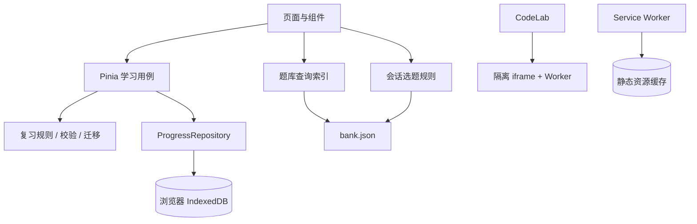

# 架构说明

## 目标与当前边界

知序是部署在现有 `/quiz/` 路径的响应式 Web + PWA。当前采用浏览器本机数据架构：静态题库随版本发布，学习状态由 Pinia 管理，IndexedDB 保存快照，Service Worker 缓存应用资源。服务器只提供静态文件。

此阶段把练习、数据规则和浏览器设施分开，使界面调整、题库维护和未来数据服务接入可以分别推进。当前未实现用户账号、远程 API、云端同步、多人协作或 LLM 评分。

## 模块边界



| 模块 | 责任与依赖 |
| --- | --- |
| `src/domain/types.ts` | 题库、学习记录、会话和快照的共同契约 |
| `src/data/content.ts` | 载入并深冻结题库，建立题目、专题、追问链、分组索引 |
| `src/domain/session.ts` | 每日练习、专题练习、追问、复习和模拟面试选题；稳定选项排序与判题 |
| `src/domain/progress.ts` | 自评后的状态与日期、统计、旧数据迁移、备份校验；不调用浏览器存储 |
| `src/infrastructure/progress-repository.ts` | IndexedDB 读写、写入序列化、原始旧数据保存和等待写入完成 |
| `src/stores/learning.ts` | 初始化、编辑、评分、会话保存、统计暴露、导入导出与错误状态 |
| `src/views/` | 路由参数、用户输入、列表与页面布局；通过 store 改学习状态 |
| `src/components/AnswerContent.vue` | 展示答案、原理、例子、追问和来源，作为文本渲染 |
| `src/infrastructure/code-runner.ts` | 隔离手写代码运行、限制单次执行时间、校验返回结果 |
| `src/App.vue` | 应用壳、导航、全局搜索、安装、联网状态和版本更新提示 |

页面不直接读写 IndexedDB。领域规则可以在 Node 测试环境中验证，仓储通过 `fake-indexeddb` 验证。当前使用一个 Pinia 学习 store；它承担应用编排，不把渲染布局或代码执行细节放入其中。

## 内容模型

`Bank` 的 `schemaVersion` 为 `1`，内容版本为 `2026.11.23`。规模为 946 道题、31 个专题、30 个追问分组、163 条追问链和 30 项简历对照。

| 结构 | 主要字段 |
| --- | --- |
| `StudyQuestion` | `id`、`kind`、`prompt`、`choices`、`correctAnswer`、`explanation`、`detail`、`topicId` / `chainId` |
| `Topic` | `id`、标题、描述、难度、分类、封面参数、`questionIds` |
| `Chain` | `id`、标题、`groupId`、有顺序的 `questionIds`、检查点与来源 |
| `Group` | `id`、标题、`chainIds` |
| `CoverageItem` | 原简历对照字段：依据、已有/新增链引用、需核实项和证据提示 |

题目 ID 延续旧内容定位：专题题为 `quiz:<原关卡 ID>:<题目序号>`，口述题为 `oral:<追问链 ID>:<步骤序号>`。这些 ID 同时用作学习记录外键。应新增新 ID，保留已有题目的 ID；删除或重编号题目时需要配套记录迁移策略。

题库中的 `detail` 支持原理、示例、代码、易错点、追问与来源，但不是每题都有全部字段。当前内容校验检查数量、引用、选项与答案合法性、HTTPS 来源结构；它不会自动判断所有答案是否充分或技术结论是否正确，内容审阅仍需逐题完成。

`scripts/export-content.mjs` 是从可信旧版目录一次性导入的工具，会执行旧数据脚本。它不是任意外部题库的安全导入器，也不是日常构建步骤。当前应直接维护 `bank.json`，原始数据保留在 `legacy/` 供追溯和回归校验。

## 学习状态与会话

`ProgressSnapshot.version` 为 `2`：

```text
records[questionId] → status / attempts / correct / note / draft / bookmarked
                      lastReviewedAt / nextReviewAt
session             → 当前会话，可为空
history             → 会话记录，完成会话按 ID 更新，最多保留 500 条
evidence[itemId]     → 简历项目证据笔记
code[labId]          → 手写代码草稿
dailyGoal           → 每日目标，默认 10，合法范围 1～100
activity[本地日期]   → 当天评分次数
xp                  → 累计积分
migratedAt          → 可选的旧数据迁移时间
```

`LearningRecord.status` 为 `new`、`learning` 或 `mastered`。当前复习规则是简单、可解释的固定间隔：还需练习或客观题答错安排 10 分钟后；掌握安排 1 天后；熟练安排 3 天后。它不是 SM-2、FSRS 或基于模型的掌握概率预测。口述题以用户自评为依据。

`StudySession` 保存题目队列、当前下标、每题回答/选项/展示状态/自评以及开始、完成时间。选项展示顺序由会话 ID 与题目 ID 决定，刷新后保持一致；判题使用原始答案索引，判断题的 `false` 不是未作答。

每日练习优先加入薄弱和到期题，再补充新题，避免将未学过前置问题的追问单独加入。模拟面试从不同分组各选一条链的开场题，共 12 题；回答阶段隐藏参考答案，完成后回看与自评。普通复习队列上限为 30 题。

## 持久化、恢复与兼容

IndexedDB 数据库为 `interview-workbench-v2`，数据库版本为 `1`，对象仓库为 `state`。`progress` 保存学习快照，`revision` 保存单调递增的提交版本，`legacy-backup` 保存旧版原始载荷。仓储将快照复制后串行写入，拒绝比已提交版本更旧的写入；`flush()` 用于等待队列。

每次编辑先同步写入 `localStorage` 的 `interview-workbench.v2.pending`，内容为日志版本、提交版本和完整学习快照，再异步写入 IndexedDB。事务完成后清理不比已提交版本新的日志。启动时比较日志与数据库版本，恢复较新的有效日志，解决输入后立即刷新时异步事务尚未提交的问题。无法识别的待保存日志会触发恢复保护并保留原始内容用于导出。

浏览器通过 Web Locks 的 `interview-workbench-v2-writer` 独占锁限制同源只有一个编辑窗口。未获得锁的窗口显示只读提示和备份入口，不进入编辑页面；关闭原窗口后刷新重试。离开页面释放锁。不支持 Web Locks 的浏览器也进入受限状态，避免无协调写入。该机制防止并行覆盖，不提供多窗口状态合并或实时协作。

初次启动且不存在新版数据时，读取同源 `localStorage` 的两个旧键：

- `quiz-game.progress.v1`：错题、XP 与未完成的专题练习。
- `frontend-deep-review-2026-v1`：口述自评、笔记、草稿、简历证据、代码与口述/模拟会话。

迁移只关联仍存在的题目，保留原始载荷，不删除旧键。旧关卡星级不转换成逐题掌握度，旧数据没有的学习日历不会被推算。已存在的新版数据优先使用，重复启动不重复迁移。

保存失败会在应用壳显示错误，内存中的当前输入仍可导出。发现无法识别的已有快照时停止覆盖，并允许导出该原始数据和当前临时输入；用户导入有效备份后解除恢复状态。

备份外层包含 `app: "interview-workbench"`、`exportVersion: 1`、导出时间、`progress` 和可选 `legacyBackup`。导入先完整校验版本、字段、长度、题目引用、日期、会话、统计范围及危险键名，再持久化并替换内存状态。界面提供替换确认。导出会等待待写入队列，并在持久化失败时保留内存数据以供恢复。

数据属于浏览器的站点存储。相同服务器使用不同域名、IP、协议或端口访问时可能属于不同来源；跨来源迁移应使用 JSON 备份。同一浏览器的安装版 PWA 仍受浏览器存储生命周期管理。目前没有多标签页冲突合并机制，也没有跨设备同步协议。

## PWA 与发布

Vite 构建基路径、manifest 范围和应用入口统一为 `/quiz/`。Vue Router 使用 Hash 路由，不要求静态服务为每个页面额外配置回退。旧 `#map`、`#home`、`#quiz` 等入口做兼容归一化或跳转。

`vite-plugin-pwa` 生成 Service Worker，Workbox 预缓存 JS、CSS、HTML、SVG、PNG、JSON 和字体文件。首次联网完成缓存后，核心题库与学习功能可离线使用；外部来源网页仍需联网。离线能力依赖支持 Service Worker 的安全上下文及浏览器正常存储权限。

更新采用提示模式：新资源准备好后显示更新入口，点击「保存并更新」等待当前写入，再激活新版本并刷新。旧缓存由 Workbox 清理。应用资源缓存与学习 IndexedDB 分开管理，资源更新不通过删除数据库实现。

服务器交付物为 `dist/`。保持现有 HTTPS → Caddy → Nginx 静态路径，构建环境需要 Node，线上静态服务无需 Node 进程。部署应完整发布资源并保留上一版，避免 HTML、Service Worker 与哈希资源处于混合版本。

`scripts/deploy-release.py` 接收归档路径、归档 SHA-256、基线 JSON 路径、基线 SHA-256 和发布提交 ID。它拒绝路径穿越、符号链接或其他非普通归档成员，核对当前线上目录的完整文件清单与哈希，然后写入同级备用目录。发布使用 Linux `renameat2(RENAME_EXCHANGE)` 原子交换 `/var/www/quiz` 和备用目录；前一版本保留在备用目录，发布后校验失败则反向交换恢复。整个流程仅处理该静态站点目录。

初次迁移基线对应旧版 `0fa092c`，基线清单可以声明 `normalize_crlf: true`，仅用于消除旧文本行尾差异；新版本哈希始终按实际字节计算。脚本不自行获取 SSH 凭据，也不自动接受线上未知变更。`public/third-party-notices.txt` 随 `dist/` 一起发布，保留第三方许可文本。

## 代码练习边界

代码运行器只处理本应用 `labs` 配置的练习用例，单次代码长度限制为 100,000 个字符。运行位于仅允许脚本的 sandbox iframe 内，由 Worker 执行；iframe 使用限制连接的 CSP，主页面以消息来源和随机通道校验结果。超时 3 秒销毁运行环境，用户也可停止。它不提供服务器执行、npm 依赖安装或通用在线判题服务。

## 验证与扩展

运行 `npm run content:validate`、`npm test` 和 `npm run build`。测试覆盖旧版数据迁移、导入失败不覆盖、未知版本保护、IDB 写入顺序与失败、真实统计、选项身份、原始客观题答案一致性、每日选题与模拟题分组。

`npm run test:e2e` 启动 4176 端口生产预览，顺序运行 `test:browser` 与 `test:practice`，完成后关闭预览服务。需要 Playwright Chromium，或设置 `CHROME_PATH` 使用本机 Chrome；截图等产物在 `test-results/`。浏览器脚本覆盖页面、学习记录、备份、响应式、离线与练习流程。发布验收仍需检查真实设备的安装流程和新旧 Service Worker 切换。

后续接入 API 时，可在现有仓储边界上增加远程适配器，并保持领域模型不依赖 HTTP。需要新增认证、服务器版本号、幂等写入、离线操作队列、冲突解决和跨设备同步状态；这些能力当前尚未实现。若接入 AI 口述点评，应通过独立服务端代理管理密钥，分别保存用户回答、模型建议和用户自评，不把模型建议直接视为掌握结论。
