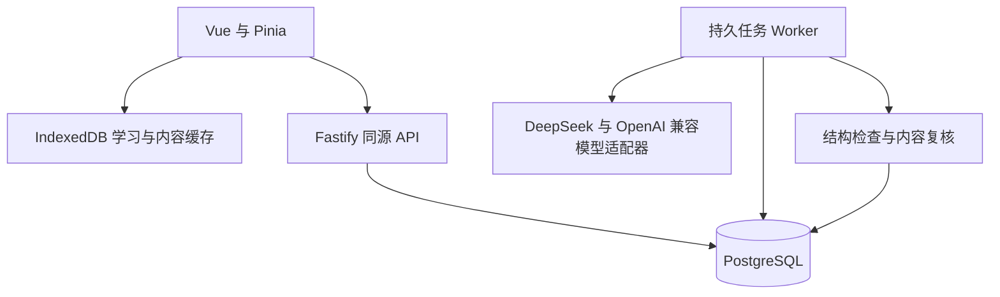

# 架构说明

知序采用 Vue 响应式 Web + PWA、TypeScript API、后台任务和 PostgreSQL。公共题库以发布清单保存，浏览器同步并缓存内容。聊天、生成题、审核与全局笔记保存在服务端；学习进度按本机账号隔离保存。

本文描述当前代码。详细功能设计见 [AI 学习方案](./ai-learning-plan.md)。

## 运行结构

开发环境可使用嵌入式 PGlite 运行相同 SQL，数据位于忽略提交的 `server/data/`。生产环境必须设置 `DATABASE_URL`，使用独立 PostgreSQL。`SERVICE_ROLE=api` 接收请求；`SERVICE_ROLE=worker` 处理后台任务；本地未指定角色时同时运行两者。

## 模块职责

| 模块                                       | 职责                                             |
| ------------------------------------------ | ------------------------------------------------ |
| `packages/contracts/ai.ts`                 | 请求与模型输出的 Zod 契约和共享类型              |
| `server/db.ts`                             | 数据库连接、事务和表结构初始化                   |
| `server/app.ts`                            | 身份、对话、任务、用量、候选题、审核、发布和笔记 |
| `server/provider.ts`                       | Chat Completions 流式与 JSON 调用                |
| `server/prompts.ts`                        | 分任务提示词及版本                               |
| `server/quality.ts`                        | 近似重复识别与独立内容复核                       |
| `src/data/content.ts`                      | 内容激活、公共与个人同步、查询索引               |
| `src/infrastructure/content-repository.ts` | 题库清单、归档与账号内容缓存                     |
| `src/stores/ai.ts`                         | 身份、会话、消息、生成任务及恢复                 |
| `src/stores/learning.ts`                   | 作答、笔记、自评、账号本地状态和备份             |
| `src/domain/`                              | 选题、判题、复习规则、内容及快照校验             |

页面通过 store 和仓储操作数据。模型密钥只存在服务端私有配置中，不进入前端构建或 API 响应。

## 内容和学习状态

公共发布清单不可变。维护者审核固定版本的候选题，再通过事务把题目和目录一起发布。恢复历史内容会创建新清单，保留发布历史。新增内容不需要重新构建前端。

个人生成默认私有。结构检查、近似重复检查和第二次模型复核产生逐题结果；仍需修订的题目不能直接保存为练习。通过检查的个人题显示“AI 生成 · 待复核”，公共发布仍需维护者审核。

题目修订保存到 `candidate_versions`。练习开始时固定 `questionSnapshots` 与选项排列，内容更新后，原会话仍按原题和答案恢复。显示位置与原始选项身份分开，每轮均衡正确位置。

IndexedDB 保存学习快照和内容。写入串行执行，修订号阻止旧写入覆盖新结果；同步待写日志保护立即刷新场景。Web Locks 限制同源同时只有一个编辑窗口。用户自评与 AI 点评分开，点评不直接改写掌握状态。

学习快照版本为 3，存储在 `zhixu-learning-v3` 及账号子库，备份格式版本为 2。根据本次清理要求，首次启动一次性删除旧学习记录库与旧待写日志，保留 `zhixu-content-v1` 中的公共和个人题库。完成标记防止之后启动时再次清空新记录；旧备份不自动导入。

## 身份和任务

账号采用邀请注册。密码使用带随机盐的 scrypt，会话令牌保存哈希。生产 Cookie 使用 Secure、HttpOnly 和 SameSite，写接口校验 Origin 与 CSRF。会话、任务、候选和笔记均校验所有者；维护操作校验管理员权限。

一次用户操作对应一个幂等键。数据库事务预留额度并入队，Worker 领取后释放事务再调用模型。行锁与 `SKIP LOCKED` 协调任务领取，递增执行令牌阻止过期结果覆盖新执行。

任务支持等待、执行、完成、部分完成、失败、取消和结果待确认。明确被上游拒绝的请求释放预留；无法确定是否执行的请求保留保守用量，不自动重复付费调用。首版额度按 tokens 和 UTC 日界统计，尚未接入货币账单对账。

SSE 发送数据库中的完整任务快照。重连读取最新状态，不重新生成；首版没有逐事件历史重放。文本定期落库，结构化题目通过检查后才启用保存和练习。

## 交互和运行边界

独立 AI Tab 与题目入口共用会话。正式模拟最多 6 组主问题、每组 2 次追问、20 分钟，结束后复盘。练习追问、自由答疑和模拟采用不同动作。模型消息使用受限 Markdown，关闭原始 HTML 与远程图片自动加载；服务器不执行模型生成的任意代码。

前端入口为 `/quiz/`，API 为 `/quiz/api/v1/`。代理优先匹配 API，Service Worker 排除 API 导航回退，私有接口不进入公共缓存。

`Dockerfile.ai` 与 `compose.ai.yml` 提供 API、Worker、PostgreSQL 的部署结构。真实模型可用性、生产数据库、代理和备份恢复需要在目标环境验收。当前学习进度仍在本机，自动跨设备同步尚未实现。
